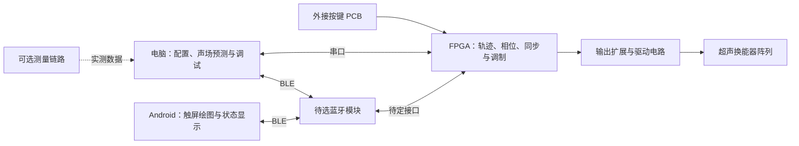

# 触见：超声触觉图形显示器

面向视障人群的基础图形与方向信息感知，探索利用超声在手掌处产生触觉反馈。

2026 年全国大学生嵌入式芯片与系统设计竞赛 FPGA 创新设计赛道参赛准备项目。

> 更新于 **2026-10-14**。仓库包含电脑上位机、Android 测试应用、串口/BLE/Demo、F411 与 F103 原型固件、4×4 / 8×8 PCB 和机械打印包。Tang MEGA 138K Pro 的 4×4 / 11 mm 配置已完成仿真、高云构建、临时下载和真实串口相位回读。F103 使用统一宏切换业务与测试。8×8 PCB 仍待移位输出适配及实板验证，机械包尚未试打印；实际声场与触觉效果尚未验证。FPGA 接收板采样链路与蓝牙模块选型仍待完成。

## 项目简介

项目拟以 Tang Mega 60K 为核心，由 FPGA 完成焦点相位计算、多通道同步控制和触觉调制，通过控制焦点的位置与运动轨迹，探索点、直线、圆等简单图形的触觉呈现。硬件先做 4×4，再扩展到 8×8；16×16/256 路作为后续方向，最终规模与驱动方案由样机测试决定。

设备保留外接 PCB 按键，支持不连接电脑时选择和播放预设图形。电脑拟通过串口或 BLE 提供参数配置、声场预测、状态监控和测量数据分析，实时轨迹执行与相位输出在 FPGA 内完成。BLE 需配套模块与固件，当前已完成电脑端适配及软件夹具验证。

## 系统组成



当前使用 Sipeed Tang MEGA 138K Pro，搭载高云 GW5AST-LV138FPG676A。旧 Tang Mega 60K
记录作为历史方案保留，不能照搬引脚；当前约束、工具与验证结果见 [上板说明](fpga/board/README.md)。

## 当前设计方向

| 部分 | 计划内容 | 尚待确定 |
|---|---|---|
| FPGA | 已实现板内相位求解、轨迹播放和 16 路输出，完成数字联调 | 驱动波形、实测声场与触觉效果 |
| 阵列与驱动 | 4×4 R5 使用 MA40S4S、11 mm 间距和 12 V 供电；已有 8×8 手工布线包 | 8×8 移位输出适配、装配与实板验证 |
| 本地操作 | PCB 外接按键，选择、播放和停止图形 | 按键数量、状态指示与接口 |
| 放手引导 | 已完成 P4 固定定位架、可换腕托与接收架；操作语音仍为提案 | 实物试打、承重与手型适配、声学工作位置及语音实现 |
| 电脑软件 | 已实现组合草图、几何关系与尺寸、手掌预览、Demo、串口与 BLE 适配 | 协议共同定稿、蓝牙选型、FPGA 固件与真实板卡联调 |
| 手机软件 | Android 触屏草图、手掌预览、图形库、JSON 互通、Demo 与 BLE | 手机原生权限、文件选择与真实蓝牙链路联调；暂不支持 iOS |
| 传感器 | 接收器用于校准；手部跟踪后置 | 接收前端、ADC、手部传感器选型 |

## 实施顺序

1. 核对板卡引脚，完成按键、串口和低压数字输出验证。
2. 验证单通道及少量驱动通道的电气性能。
3. 制作小阵列，比较计算相位、测量声场和预测结果。
4. 评估固定焦点触感与简单轨迹，再决定是否扩展至 256 路。
5. 完成独立演示、图形辨识实验及性能记录。

64 路是中间验证规模，不代表已能获得足够触感；多焦点、手部跟踪、语音图形教学及声悬浮属于后续扩展。基础放手与操作语音拟纳入首版交互。声场预测不能代替实际触觉验证。

## 文档导航

- [设计思路](设计思路.md)：当前架构、按键与串口分工、硬件选型、验证步骤和待决策事项。
- [交互与放手引导提案](交互与放手引导提案.md)：腕托与语音、使用流程、手掌示意、既定软件交互和实现状态。
- [腕托与阵列夹具打印包](hardware/mechanical/README.md)：P4 竖装发射板、可换腕托/接收架及背面接线避让；保留 P3 共用平整基准的焊装夹具。包含完全定义的 SolidWorks 草图、学校用 STL 和装配步骤，尚未实物试打。
- [PCB 版本导航](hardware/README.md)：4×4 R5 打样包、8×8 R1 手工布线扩展板及历史副本；8×8 尚待移位输出后端与实板验证。
- [FPGA 固件评审](https://github.com/Cody-ic/fpga-air-haptics/pull/8)：独立分支的串口、轨迹、相位、输出及板级约束；验证边界见对应分支文档。
- [上位机使用说明](desktop_app/README.md)：组合草图、尺寸和顺序、手掌预览、Demo 与数据边界。
- [FPGA 工程说明](fpga/README.md)：HAP3 串口、轨迹、相位求解、输出及仿真；文件名中的 `hap2_` 是历史命名。
- [HAP3 串口协议](desktop_app/PROTOCOL.md)：坐标路径、设备能力声明、完整配置提交、原子状态快照和看门狗。
- [上位机联调与验证计划](上位机联调与验证计划.md)：FPGA 最小对接清单、通信报文、异常验收、首轮图形和实验记录模板。
- [Android 应用说明](mobile_app/README.md)：触屏绘图、保存与导入、BLE、APK 构建和验证范围。
- [BLE 对接说明](desktop_app/BLE.md)：电脑端连接、可替换模块配置、双向收发和协议待决事项。
- [选题调研](FPGA赛道选题建议%281%29.md)：原始候选方案和参考资料；推荐排序及部分判断属于历史调研。
- [接收板调整建议](hardware/receiver/PCB调整建议.md)：保留分压的软件适配、焊孔/供电标识修改与接线验证。
- [贡献指南](AGENTS.md)：文档维护、核验和提交约定。
- [项目上下文](CLAUDE.md)：协作时需要了解的背景与约束。

当前方案以 `设计思路.md` 为准。旧调研中的性能目标、价格、赛事规则及“未检索到同类作品”等表述，不应直接当作实测结果或最新事实引用。

- [接收探头定位与自动调参提案](docs/proposals/2026-10-14-position-aware-haptics-calibration.md)：复用已有接收幅值与相位校准，增加自动位置反馈、测量绑定及最终 FPGA 接入计划。

## 运行与测试

MCU 先行验证：见 [NUCLEO-F411RE 固件、烧录与接线说明](firmware/nucleo_f411re/README.md)。板载 ST-LINK 虚拟串口使用 115200，支持现有上位机的“发送到设备→播放→状态回传”。PCB 文件见 [R5 首轮打样包](hardware/Haptics_4x4_R5_12VDC/README.md)。

另有 [STM32F103C8T6 CubeMX/CubeIDE 工程](firmware/stm32f103c8_cube/README.md)，包含 `.ioc`、16 路输出与接收 ADC，支持独立 ST-LINK V2 下载和 USB-UART 通信。F103 内存较小，最多接受 64 个坐标、8 段路径；已优化并烧录，通过九组图形和 30 次上位机采样回传测试，详见[2026-10-07 联调记录](firmware/stm32f103c8_cube/VALIDATION_2026-10-07.md)。

使用 Python 3.10+（含 Tk），在仓库根目录执行：

```powershell
python -m pip install -r desktop_app/requirements.txt
python -m desktop_app --demo
python -m unittest discover -s desktop_app/tests -v
```

可选界面集成测试：`python -m desktop_app.tests.gui_smoke`。Windows 可用 PyInstaller 构建独立程序，产物位于忽略的 `desktop_app/dist/`，见[启动与打包说明](desktop_app/README.md#启动)。手机端检查、MCU 构建和 FPGA 仿真分别见 [mobile_app/README.md](mobile_app/README.md)、[F103 工程说明](firmware/stm32f103c8_cube/README.md) 与 [fpga/README.md](fpga/README.md)。FPGA 的高云构建脚本为 `fpga/board/build.tcl`。

上位机默认打开草图编辑器，支持连续直线、矩形、圆、拖动成圆弧和控制点曲线，可组合多个轮廓、擦除线条、设置必要几何关系与尺寸、整体倍数缩放和指定呈现顺序。原打点操作已并入连续直线工具。公共线按顺序仅呈现一次，段间关闭输出；编译后最多 32 段、256 个坐标。图形按实际坐标保存，换阵列不会改变位置。Demo 可设置 4×4、6×6、8×8、12×12、16×16 及自定义行列；真实硬件规模由 FPGA 握手声明。普通界面保留绘图与播放，勾选“调试模式”查看相位、声场和串口日志。

顶部按钮可直接选圆、正方形、三角形、直线、箭头等基本图案，并预览待发送的形状。点击“发送到设备”后，在“播放画面”查看接收确认；确认前播放按钮置灰。播放后的亮点来自设备回传，暂停、停止和失联均有反馈。更改图形或重新连接后需再次发送确认。

“保存图形”生成 JSON，使用“导入图形”恢复编辑，支持 `Ctrl+S`／`Ctrl+O`，并显示文件名与未保存状态。预览与播放画面已使用手掌示意背景，图形保持实际坐标；手掌不是检测结果，实体腕托、语音与手部跟踪仍待实现。

硬件路线采用单焦点沿轮廓高速循环扫描，电脑一次下发完整图形，FPGA 自主执行。当前 Demo 默认两秒一圈，仅演示路径与通信；高速更新及触觉辨识效果尚未验证。

手机端使用 Flutter，进入 `mobile_app/` 后运行 `flutter pub get`、`flutter test`、`flutter run`。Windows 可在仓库根目录运行 `powershell -File mobile_app/build_android.ps1` 构建内部测试 APK，产物位于 `mobile_app/dist/`。手机向设备提交完整图形并接收状态；高速扫描仍由板端负责。详细环境及中文路径处理见手机应用说明。

板卡入门可参考 [Sipeed 官方示例](https://github.com/sipeed/TangMega-60K-example)。项目内不存放账号密码、访问令牌或与本作品无关的个人文件。
