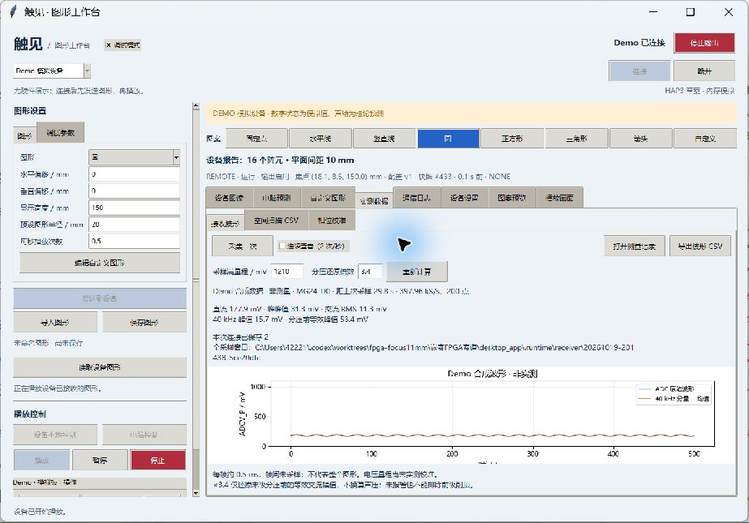

# XIAO MG24：接收采样与无线桥接

更新日期：2026-10-19。普通 XIAO MG24 即可，不依赖 Sense 的麦克风和惯性传感器。
两种模式已经交叉编译；通信内核经过电脑测试，尚未烧录 MG24 或完成无线、模拟采样实测。
正式链路不使用 STM32。FPGA（Field Programmable Gate Array，现场可编程门阵列）
负责图形、相位、64 路输出和停止保护；MG24 负责接收板采样与通信，不接管高速扫描。

## 1. 数据路径

```text
电脑串口 / 手机或电脑 BLE（Bluetooth Low Energy，低功耗蓝牙）
                       ↕
                  XIAO MG24
                  ↕       ↑ D0：接收板 ADCV_P
       命令、状态、采样触发
                  ↕
             Tang MEGA 138K Pro → 4×4 / 8×8 发射板
```

MG24 的 USB（Universal Serial Bus，通用串行总线）串口和蓝牙同时只允许一个控制者，
另一端收到 `BUSY`。不制造心跳或设备状态。蓝牙名称 `Haptics-MG24`，服务沿用上位机默认
Nordic UART Service（北欧半导体串口服务），不需要修改服务标识。

## 2. 接线：先核对实物版本

下表依据官方 **4071f、Rev.1.2** 底板原理图第 16 页；J22 即 PMOD0
（Peripheral Module，外设模块接口）。针号以实物 1 针标记为准，不用照片左右猜方向。

| 起点 | 终点 | 作用 |
|---|---|---|
| MG24 D6 / PC06 / Serial1 TX | FPGA J22-8 / L24 | MG24 发命令，FPGA 接收 |
| FPGA J22-6 / T24 | MG24 D7 / PC07 / Serial1 RX | FPGA 发应答，MG24 接收 |
| FPGA J22-5 / R17 | MG24 D2 / PC02 | 每次采样发约 10 µs 高电平触发 |
| FPGA J22-3 或 4 | MG24 GND | 数字共地 |
| 接收板 ADCV_P | MG24 D0 / PC00 | 模拟输入，保留接收板原分压和 R14 |
| 接收板 GND | MG24 GND | 模拟信号参考地 |

TX/RX 分别表示发送/接收；数字电平为 3.3 V。MG24 由自身 USB 供电，接收板按原电路
单独供电；不把发射板 12 V 接到 MG24。J22-1/2 电源脚在此方案留空。
不要同时连接旧 ADCS7476 小板、PMOD 扩展器或占用同网的麦克风阵列接口。

**MG24 版只通过 J22 接收控制，板载调试 USB 串口的 N16/P15 不再是控制入口。**
电脑应选择 MG24 的串口；需要直接使用 FPGA 调试串口时，重新构建旧接收后端并换回对应接线。
4×4 的 J23 直接输出和 8×8 的 J23→H1 移位接线见[板级说明](../../fpga/board/README.md)。

## 3. 一处宏切换，不换 main

打开 [haptics_mg24/config.h](haptics_mg24/config.h)：

```cpp
#define HAPTICS_MG24_MODE HAPTICS_MODE_BUSINESS
// 独立采样测试改为 HAPTICS_MODE_ADC_TEST
```

- **业务模式**：转发 HAP3 帧；电脑请求 `CAPTURE` 后先布置采样，再让 FPGA 发触发脉冲。
  同一请求的真实样本和 FPGA 元数据均到齐后才回传。初始化失败、超时或坏帧明确报错。
- **独立采样测试**：不发阵列控制命令，每 2 秒本地采集一次，通过串口输出
  `MG24_ADC_TEST fs_hz=... full_scale_mv=... error=... raw=...`。
  蓝牙名称改为 `MG24-ADC-TEST`，该模式不提供业务协议会话。

两种模式共用 `.ino`、采样驱动和工程。目标采样率、样本数、波特率在同一配置头中；
目前协议固定 200 点，模拟输入固定 D0，不应只改引脚宏假装迁移底层模拟路由。

## 4. 开发环境与编译

已验证 Arduino CLI（Command Line Interface，命令行接口）1.5.1、
Silicon Labs 开发板包 **4.0.0**；开发板选 XIAO MG24，协议栈选 **BLE (Silabs)**。
不能选 ArduinoBLE、Matter 或不含蓝牙的配置。开发板包索引：
`https://siliconlabs.github.io/arduino/package_arduinosilabs_index.json`。

从仓库根目录执行，构建脚本使用纯英文暂存目录，**只编译，不烧录**：

```powershell
python firmware/xiao_mg24/build.py --mode business --config D:/tools/arduino-cli/arduino-cli.yaml
python firmware/xiao_mg24/build.py --mode adc-test --config D:/tools/arduino-cli/arduino-cli.yaml
```

可通过 `--cli`、`--stage` 指定工具和目录。脚本的 `--mode` 覆盖头文件默认宏；
在 Arduino IDE（Integrated Development Environment，集成开发环境）直接打开
`haptics_mg24/haptics_mg24.ino` 时，则使用头文件的宏。使用板载 USB 下载，无需 ST-LINK；
实物到位后按 Seeed 官方流程选择端口和上传，当前未代为烧录。

FPGA 配套程序必须同时选对阵列和接收后端，在其 `fpga/board` 英文暂存目录执行：

```powershell
$env:HAPTICS_ARRAY = '8x8'        # 4×4 改成 4x4
$env:HAPTICS_PINOUT = 'j23'
$env:HAPTICS_RECEIVER = 'mg24'
$env:HAPTICS_DEVICE_VERSION = 'B' # 依据实物芯片标记；不能据下载识别码推断
& '<高云安装目录>/IDE/bin/gw_sh.exe' build.tcl
```

## 5. 采样含义与限制

使用 IADC（Incremental Analog-to-Digital Converter，增量式模数转换器）12 位模式、
内部标称 **1.21 V** 参考；接收板名义 0～0.971 V 输入不需要改分压。
采样由定时器、PRS（Peripheral Reflex System，外设事件通道）和
DMA（Direct Memory Access，直接存储器访问）完成，不用 `analogRead()` 循环凑速率。
占用 TIMER0、D0、D2、一个分配的同步事件通道及一个动态分配的数据搬运通道。

目标每秒 400000 点；实际整数分频率由时钟算出并回传 `fs_hz`，不硬写假值。
每帧 200 点，约 0.5 ms；传完后才接受下一窗口，不是连续示波器。
首个样本受触发中断延迟影响，**不提供与发射时钟同相的绝对相位测量**；
幅值式逐通道干涉校准不依赖这个绝对起点。

电脑按 `pin=MG24_D0` 和 `full_scale_mv=1210` 换算，保存原码、实际速率、启动标识和配置版本。
40 kHz 分量用常数项加正余弦最小二乘拟合，支持窗口包含非整数周期。
这仍是未标定电压；无线噪声、模拟建立时间、参考误差和实际有效精度尚待测量。
单点电压不等于声场地图或绝对声压，缺数据不会补成 Demo 波形。

## 6. 通信与故障处理

串口 115200、8 位数据、无校验、1 位停止。完整帧校验后才转发；蓝牙通知分包发送，
缓存溢出中止会话。采样最长等待 1500 ms；不同请求或取消后的迟到样本会被丢弃。
业务期间采样允许探活、读状态和停止，其他修改命令暂回 `ADC_BUSY`。

控制者 5 秒无有效请求释放所有权。已确认电脑控制模式时尽力发送停止；
本地模式保留独立运行。真正的远程失联停机仍由 FPGA 自己的心跳保护保证，
MG24 不替主机续命。上电和重新握手不自动播放。

## 7. 电脑端检查

使用本次重新构建的上位机，连接 MG24 串口或扫描蓝牙；握手会检查 FPGA 声明
`receiver=MG24`。连接旧后端会报 `RECEIVER_MISMATCH`，不能混用烧录文件。
“调试模式 → 实测数据 → 接收波形”可采样、查看和导出，自动记录使用设备报告的量程。



## 8. 软件验证与实物验收

```bash
bash firmware/xiao_mg24/tests/run_host.sh
python -m unittest discover -s desktop_app/tests -v
python -m desktop_app.tests.receiver_gui_smoke
```

电脑测试覆盖分包、校验、双端抢占、采样先后顺序、取消、迟到回调、超时及本地模式断开。
另以外设行为模型运行真实采样驱动，检查队列重新使能、等待触发、恰好 200 点、
取消后重新采集、数据搬运启动失败及缓冲溢出；模型不验证电气精度或无线中断时延。
4×4/8×8 构建与时序结果见[本轮核验](../../fpga/board/RELEASE_2026-10-19_MG24.md)。
实物还需依次验证：静态电压、已知 40 kHz 输入与示波器对照、连续请求、无线并发采样噪声、
长图形双向传输、断线停止，最后才接阵列做逐通道校准；当前不能宣称这些已通过。

## 9. 官方依据

- [Seeed MG24 入门与引脚表](https://wiki.seeedstudio.com/xiao_mg24_getting_started/)：普通/Sense、D0/D2/D6/D7、板载下载。
- [Silicon Labs EFR32xG24 参考手册](https://www.silabs.com/documents/public/reference-manuals/efr32xg24-rm.pdf)：内部 1.21 V 参考、采样触发和外设。
- [EFR32MG24 数据手册](https://www.silabs.com/documents/public/data-sheets/efr32mg24-datasheet.pdf)：12 位最高速率；标称能力不等于本板有效精度。
- [Arduino Core 4.0.0](https://github.com/SiliconLabs/arduino/releases/tag/4.0.0)：本次实际交叉编译使用的库与工具。
- [Silicon Labs 单通道定时触发示例](https://github.com/SiliconLabsSoftware/peripheral_examples_gsdk/blob/master/series2/iadc/iadc_single_letimer_prs_ldma/src/main_single_letimer_prs_ldma.c)：外部触发仍须使能转换队列；2026-10-20 自检据此补齐每次采样前的重新使能。
- [Sipeed 4071f 原理图 Rev.1.2](https://dl.sipeed.com/fileList/TANG/Mega_138K_Pro/02_Schematic/TANG_MEGA-138K_Pro-Dock-4071f_Schematics.pdf)，2024-10-10，第 16 页 J22；实物版本须核对。

外部资料于 2026-10-19 核对；测试范围以本仓库核验记录为准。
