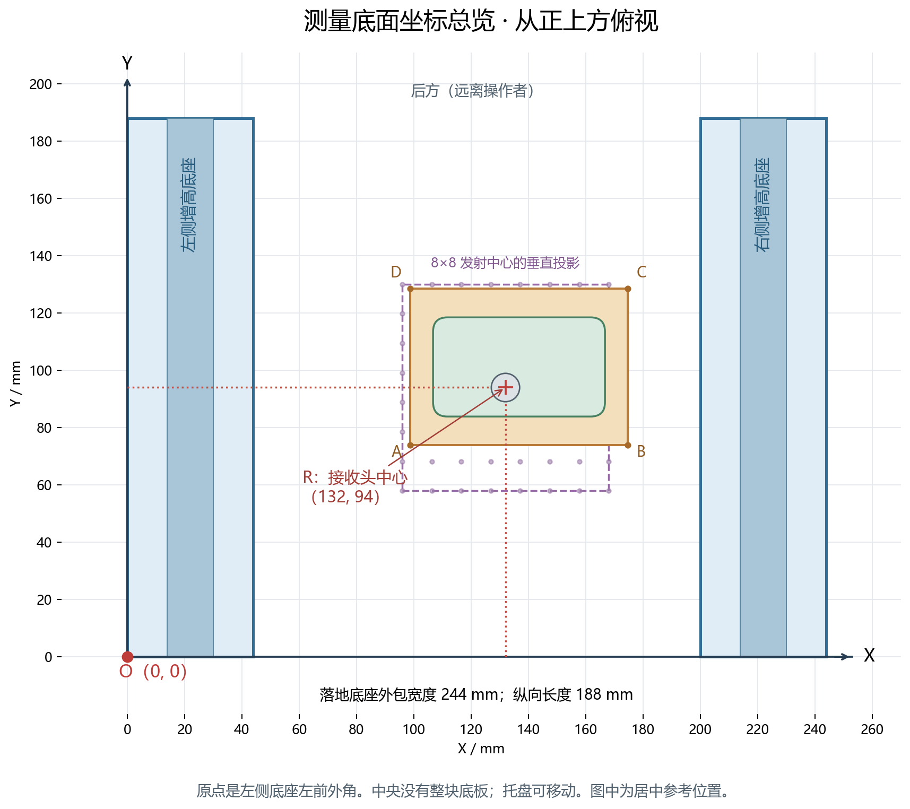
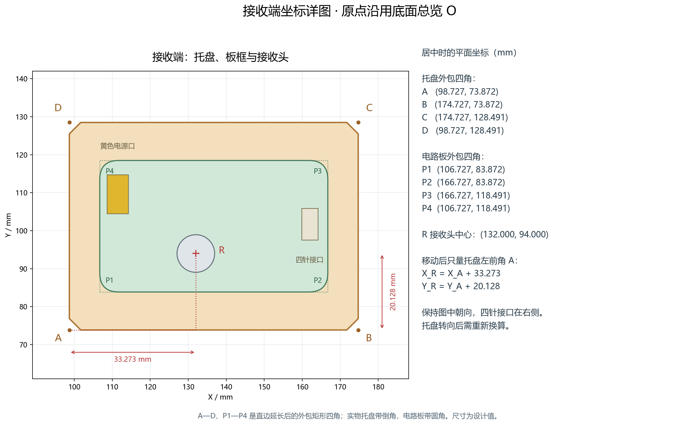

# 声场测量底面坐标

2026-10-23。适用于 P5 支架加装 30 mm 固定增高底座的布局。图中坐标单位均为毫米，按设计尺寸计算；实际安装与摆放位置需用尺测量。

## 1. 原点与方向

从上往下看，站在图下方。接收板换能器朝上，四针接口在右侧、黄色电源口在左后方。取**左侧增高底座的左前外角在桌面上的落点 O 为 (0,0)**；向右为 X 正方向，向后、远离操作者为 Y 正方向。用胶带沿两条底座直边延长出坐标轴，支架移动后需重新建立基准。

落地底座的外包范围为 244×188 mm。两条底座间是桌面，没有新增整块底板。发射阵列中心的垂直投影是 **(132,94)**；它相对落地外包矩形中心向右偏 10 mm，不能只量整个外框的一半来找声轴。



## 2. 接收托盘与电路板四角

下表是**接收头对准声轴时的参考摆放位置**。A、B、C、D 按左前、右前、右后、左后顺序标出托盘四角；P1 至 P4 以同样顺序标出电路板四角。实物托盘有倒角、电路板有圆角，四角采用直边延长线的交点，测量时贴靠直边确定位置。

| 标记 | 对应位置 | X | Y |
|---|---|---:|---:|
| A | 托盘左前角 | 98.727 | 73.872 |
| B | 托盘右前角 | 174.727 | 73.872 |
| C | 托盘右后角 | 174.727 | 128.491 |
| D | 托盘左后角 | 98.727 | 128.491 |
| P1 | 电路板左前角 | 106.727 | 83.872 |
| P2 | 电路板右前角 | 166.727 | 83.872 |
| P3 | 电路板右后角 | 166.727 | 118.491 |
| P4 | 电路板左后角 | 106.727 | 118.491 |
| R | 接收换能器声面中心 | 132.000 | 94.000 |



## 3. 移动后怎样填写测量坐标

保持托盘朝向与图一致，只平移、不旋转。测出托盘左前角 A 的位置后，接收头中心坐标为：

```text
接收头 X = 托盘左前角 X + 33.273
接收头 Y = 托盘左前角 Y + 20.128
```

例如实测 A 为 `(100,75)`，则本次波形对应的接收头坐标是 **`(133.273,95.128)`**。声场图应记录这个接收头坐标及实际测得的幅值；A 的坐标是用于换算的辅助量。小数是设计偏移，不要求用尺子测到 0.001 mm。

若托盘旋转，固定偏移的方向也会旋转，不能继续直接相加。每次测量记录高度和朝向；接收板与上位机并不会自动知道托盘移动了多少。

## 4. 高度和现有软件

本坐标系的桌面为 Z=0，Z 向上。接收器声面中心为 `(132,94,24.7)`，发射阵列声面中心为 `(132,94,124.7)`；声面间距为 100 mm。膜面下表面高度为 24.7 mm，上表面为 24.71 mm。

二维声场图采用本图的 X、Y。当前上位机空间扫描导入文件包含 `x_mm,y_mm,value`，导入前需统一采用同一种原点和轴向；当前程序不会自动判断或转换本坐标约定。软件中的聚焦距离仍是距发射面约 100 mm，不能将桌面坐标 `(132,94,24.7)` 原样当作阵列中心坐标指令下发。

本次只新增坐标说明、图与数据，不改变固件通道对应关系。64 个发射声面中心在本底面坐标中的位置见 [coordinates.json](coordinates.json)；其中元件位号来自电路板，不能当成电气通道编号。
